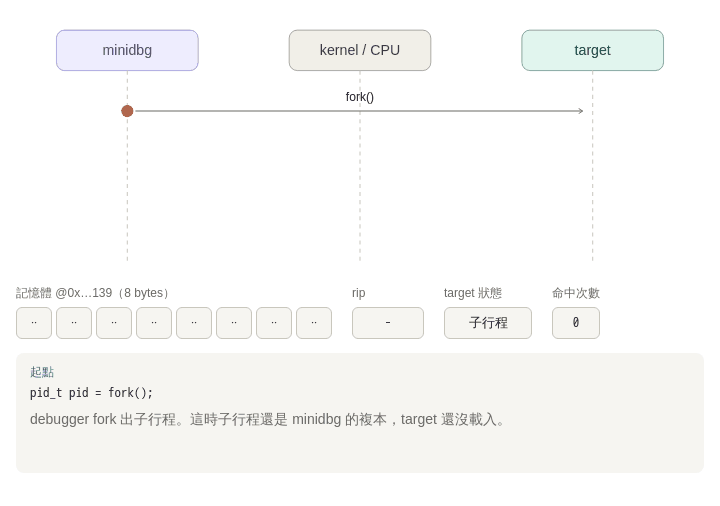

# mini-debugger

A ~50-line software-breakpoint debugger built on `ptrace`, used to trace step by step how gdb's `break` works.

- [minidbg.c](minidbg.c): the debugger
- [target.c](target.c): the program being debugged (`square()` is called 3 times)
- [animation.html](animation.html): interactive step-by-step animation (open locally in a browser; ←/→ to step)



The orange dot shows who notifies whom: minidbg and target never talk directly, everything goes through the kernel. The first memory cell turns `cc` when the breakpoint is armed and `55` while it is temporarily restored (E1–E3). The GIF is rendered from `animation.html` by [record.py](record.py).

> Linux only (macOS `ptrace` has no PEEKTEXT/POKETEXT). On a Mac, run it in Docker:
>
> ```bash
> docker run --rm -it -v "$PWD":/w -w /w gcc:13 bash
> make run
> ```

## Step 0: Find the breakpoint offset statically

```
$ nm target | grep square
0000000000001139 T square

$ objdump -d --disassemble=square target
0000000000001139 <square>:
    1139:  55          push   %rbp          ← breakpoint goes here, on byte 0x55
    113a:  48 89 e5    mov    %rsp,%rbp
    113d:  89 7d fc    mov    %edi,-0x4(%rbp)
```

`0x1139` is only an **offset inside the ELF**. A PIE executable has no real address until it is loaded.

## Full output

```
$ make run
[dbg] breakpoint @ 0x562ec4d72139: 55 -> cc
[dbg] hit #1  rip=0x562ec4d7213a  arg(rdi)=1
square(1) = 1
[dbg] hit #2  rip=0x562ec4d7213a  arg(rdi)=2
square(2) = 4
[dbg] hit #3  rip=0x562ec4d7213a  arg(rdi)=3
square(3) = 9
[dbg] tracee exited with 0
```

Watch the debugger's syscalls with `strace -e trace=ptrace,wait4 ./minidbg ./target 1139` (trimmed below).

## Step-by-step trace

### [A] fork + TRACEME + exec: the tracee stops at its first instruction

```
 minidbg (parent)                kernel                       child
 ────────────────                ──────                       ─────
 fork() ───────────────────────────────────────────────────►  ptrace(TRACEME)
                                                               → parent becomes tracer
 waitpid() blocks                                              execv("./target")
                                 tracee finishes exec:
                                 new address space set up,
                                 sends itself SIGTRAP and stops ◄──┘
 waitpid() returns ◄──────────── WIFSTOPPED, SIGTRAP
```

```
wait4(175, [{WIFSTOPPED(s) && WSTOPSIG(s) == SIGTRAP}], 0, NULL) = 175
```

At this moment `target` is mapped into memory but **not a single user-mode instruction of it has run**. This is the window for setting breakpoints.

### [B] Compute the runtime address → PEEK → POKE 0xCC

```
load_base: first line of /proc/175/maps   0x557de9dee000-... r--p 00000000 ... /w/target
                                         + 0x1139
addr                                     = 0x557de9def139
```

```
ptrace(PTRACE_PEEKTEXT, 175, 0x557de9def139, [0x8bfc7d89e5894855]) = 0
ptrace(PTRACE_POKETEXT, 175, 0x557de9def139, 0x8bfc7d89e58948cc) = 0
```

PEEKTEXT reads one word (8 bytes) at a time. x86 is **little-endian**, so the lowest byte comes first in memory:

```
 value 0x8bfc7d89e5894855
 memory  139 13a 13b 13c 13d 13e 13f 140
        ┌───┬───┬───┬───┬───┬───┬───┬───┐
 before │55 │48 │89 │e5 │89 │7d │fc │8b │  ← matches objdump exactly
        └───┴───┴───┴───┴───┴───┴───┴───┘
        ┌───┬───┬───┬───┬───┬───┬───┬───┐
 after  │cc │48 │89 │e5 │89 │7d │fc │8b │  only (orig & ~0xff) | 0xcc changes
        └───┴───┴───┴───┴───┴───┴───┴───┘
```

`.text` is `r-xp` (read-only). The write still succeeds because the kernel writes with `FOLL_FORCE`, which triggers **Copy-on-Write**: the tracee gets a private copy of that page, and other processes plus the file on disk are unaffected.

### [C] CONT → the CPU executes 0xCC → trap

```
ptrace(PTRACE_CONT, 175, NULL, 0) = 0
--- SIGCHLD {si_code=CLD_TRAPPED, si_status=SIGTRAP} ---
wait4(175, [{WIFSTOPPED(s) && WSTOPSIG(s) == SIGTRAP}], ...) = 175
```

```
 tracee: main → call square → fetch 0x...139 = 0xCC (int3)
              → #BP exception → kernel → SIGTRAP → tracee stops (TASK_TRACED)
              → parent's waitpid wakes up
```

### [D] GETREGS: rip is already 1 past the breakpoint

```
ptrace(PTRACE_GETREGS, 175, {... rdi=0x1, ... rip=0x557de9def13a ...})
```

- `rip = ...13a = addr + 1`: `int3` is a 1-byte **trap**, so the CPU reports the address *after* that instruction.
- `rdi = 1`: in the System V ABI the first argument is passed in `rdi`, so we can read `square(1)`'s argument directly. gdb's `info args` works on the same idea (plus DWARF).

### [E1–E4] Step over the breakpoint: the key 4-step dance

```
ptrace(PTRACE_POKETEXT, 175, ...139, 0x8bfc7d89e5894855)   E1 restore 0x55
ptrace(PTRACE_SETREGS,  175, {... rip=0x557de9def139 ...})  E2 rip back to 139
ptrace(PTRACE_SINGLESTEP, 175, NULL, 0)                     E3 execute push %rbp only
wait4(...) SIGTRAP                                              (TF single-step → #DB)
ptrace(PTRACE_POKETEXT, 175, ...139, 0x8bfc7d89e58948cc)   E4 put 0xCC back
ptrace(PTRACE_CONT, 175, NULL, 0)                           → back to [C]
```

```
 text @139    rip
 ─────────    ─────
 cc 48 89..   13a     ← [D] just hit
 55 48 89..   13a     ← E1
 55 48 89..   139     ← E2
 55 48 89..   13a     ← E3 push %rbp done; now inside the mov
 cc 48 89..   13a     ← E4 breakpoint re-armed, ready for next call
```

Then the loop repeats: `square(2)` and `square(3)` hit it again, and finally `wait4` returns `WIFEXITED`.

## Mapping to gdb

| minidbg | gdb |
|---|---|
| `fork` + `TRACEME` + `execv` | `run` |
| `nm` + `/proc/pid/maps` | symbol table / DWARF + `info proc mappings` |
| PEEK + POKE `0xcc` | `break square` (inserted lazily, right before resuming) |
| `waitpid` + `GETREGS` | `Breakpoint 1, square (x=1)` |
| E1–E4 | the "step over breakpoint" inside `continue` |

## Exercises (predict first, then run)

1. **Remove E4**: how many times does the breakpoint fire? Why?
2. **Remove E1 and E2** (just CONT from `rip=...13a`): the tracee runs `48 89 e5` directly and `push %rbp` is skipped. What happens when `square` returns?
3. **Run `strace -f`**: why does the child's `ptrace(PTRACE_TRACEME)` get `EPERM`? (Hint: a process can only have one tracer.)
4. **Observe COW**: at [A] and right after [B], compare the `Private_Dirty` of the `r-xp` segment of `target` in `/proc/<pid>/smaps`.
5. **Swap in a non-PIE target** (`-no-pie`): `nm` now gives an absolute address, so `load_base + offset` is wrong. How would you fix it?
